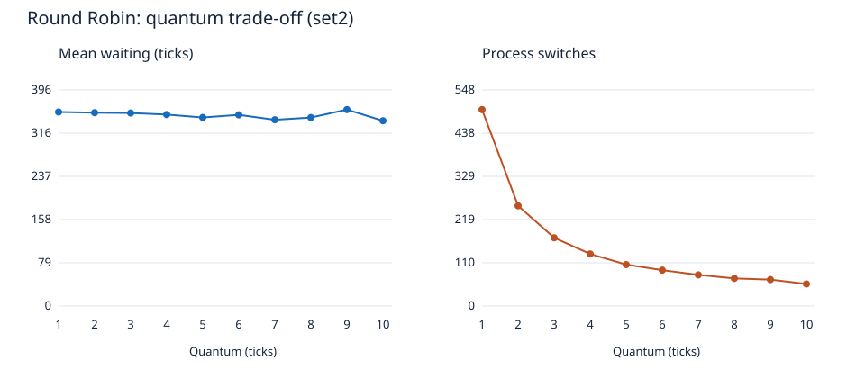

# Практическая работа № 5. Симулятор планирования CPU

Автор: ISLAM (IIDEV1). Дисциплина: операционные системы.

Цель: реализовать алгоритмы планирования CPU, сравнить ожидание, оборот и отклик, исследовать квант RR, старение и MLFQ; проверить влияние nice и SCHED_FIFO в Linux.

## Запуск на чистой Ubuntu

Для симулятора достаточно штатных **Python 3.10+ и Bash**, без pip и сторонних библиотек. Проверено в Ubuntu/WSL2, Python 3.14.4, ядро 6.6.87.2-microsoft-standard-WSL2.

Из папки `practice-5` одна команда выполняет тесты, генерирует наборы и отчёт:

```bash
bash run.sh
```

Требуемый методичкой интерфейс:

```bash
python3 sched.py --algo rr --quantum 3 set1.txt
python3 sched.py --algo srtf set1.txt
python3 sched.py --algo priority --aging 2 aging.txt
python3 sched.py --algo mlfq --boost 20 set3.txt
```

`--json` выводит интервалы и все метрики в JSON. Ошибки аргументов/данных завершают программу с кодом 2 и сообщением. При импорте доступна единая функция `simulate(processes, algorithm, **params)`, возвращающая `(start, end, pid)`; `metrics` проверяет интервалы и рассчитывает показатели.

## Файлы и входные данные

- `sched.py` — FCFS, невытесняющий SJF, SRTF, вытесняющий Priority, RR и MLFQ.
- `test_sched.py` — контрольные расписания, границы RR, вытеснение, aging, MLFQ, простои, некорректный ввод и 300 случайных проверок инвариантов.
- `report.py` — воспроизводимая генерация set2/set3, таблиц и SVG-графика без дополнительных библиотек.
- `linux_experiment.py` — реальные измерения `/proc/PID/schedstat`, nice и chrt.
- `results/` — сохранённые таблицы, расписания, график, результаты тестов и Linux-эксперимента.

Формат: `PID arrival burst priority`. Время целое, arrival ≥ 0, burst > 0, PID уникален. Меньшее числовое значение priority означает более высокий приоритет.

**Происхождение:** set1 точно воспроизводит arrival/burst из методички, приоритеты для него установлены равными 0, поскольку не указаны. Файлы преподавателя set2/set3 не приложены. Здесь созданы собственные наборы по описанию: set2 — 20 CPU-bound процессов с burst 12…40, seed=42; set3 — всего 20 процессов, из которых один длинный (80 тактов) и 19 коротких (1…3 такта), прибывающих каждые два такта. Это не выданные преподавателем set2/set3. `aging.txt` — отдельный демонстрационный набор.

## Правила моделирования и метрики

Один CPU, один CPU-burst на процесс, без I/O; стоимость переключения равна нулю. При равенстве ключей выбирается более раннее прибытие, затем порядок во входном файле. FCFS/SJF не вытесняют процесс; SRTF/Priority пересматривают выбор каждый такт.

RR сначала добавляет все новые процессы с arrival ≤ текущему времени, затем возвращает процесс с истёкшим квантом. Поэтому прибывший точно на границе идёт раньше вытесненного. По умолчанию q=3.

- Оборот = завершение − прибытие.
- Ожидание = оборот − burst.
- Отклик = первый запуск − прибытие.
- CPU utilization = сумма burst / время от 0 до последнего завершения × 100%. Начальные простои включены.
- Переключение = смена одного работающего PID другим, без переходов из/в IDLE и без первого запуска. Повторная выдача CPU тому же PID не считается переключением. Соседние интервалы одного PID объединяются.

Загрузка на всех трёх наборах равна 100%, поскольку нет промежутков, когда все процессы отсутствуют/завершены до конца эксперимента. Это свойство модели, а не измеренная загрузка настоящего компьютера.

## Проверка set1 и ошибка в методичке

SRTF: `0–1 P1 | 1–5 P2 | 5–10 P4 | 10–17 P1 | 17–26 P3`.
Ожидания: 9, 0, 15, 2; среднее **6,5**. Обороты: 17, 4, 24, 7; среднее **13,0** — совпадает с эталоном.

RR (q=3): `0–3 P1 | 3–6 P2 | 6–9 P3 | 9–12 P4 | 12–15 P1 | 15–16 P2 | 16–19 P3 | 19–21 P4 | 21–23 P1 | 23–26 P3`.
Ожидания: 15, 11, 15, 13; среднее **13,5**. Обороты: 23, 15, 24, 18; среднее **20,0** — совпадает с эталоном.

**Для FCFS в методичке арифметическая ошибка.** Расписание однозначно: `0–8 P1 | 8–12 P2 | 12–21 P3 | 21–26 P4`.

| PID | Прибытие | Burst | Завершение | Ожидание | Оборот |
|---|---:|---:|---:|---:|---:|
| P1 | 0 | 8 | 8 | 0 | 8 |
| P2 | 1 | 4 | 12 | 7 | 11 |
| P3 | 2 | 9 | 21 | 10 | 19 |
| P4 | 3 | 5 | 26 | 18 | 23 |
| Среднее | | | | **8,75** | **15,25** |

Указанные в документе 9,25 и 15,75 не следуют из данных. Код и тесты используют результат явного расчёта, а не подгонку под ошибочные числа.

## Сравнение алгоритмов (A/B и MLFQ)

| Набор | Алгоритм | Ожидание | Оборот | Отклик | CPU, % | Переключения |
|---|---|---:|---:|---:|---:|---:|
| set1 | fcfs | 8.75 | 15.25 | 8.75 | 100.00 | 3 |
| set1 | sjf | 7.75 | 14.25 | 7.75 | 100.00 | 3 |
| set1 | srtf | 6.50 | 13.00 | 4.25 | 100.00 | 4 |
| set1 | rr | 13.50 | 20.00 | 3.00 | 100.00 | 9 |
| set1 | priority | 8.75 | 15.25 | 8.75 | 100.00 | 3 |
| set1 | mlfq | 14.25 | 20.75 | 0.00 | 100.00 | 15 |
| set2 | fcfs | 219.00 | 244.00 | 219.00 | 100.00 | 19 |
| set2 | sjf | 184.95 | 209.95 | 184.95 | 100.00 | 19 |
| set2 | srtf | 179.20 | 204.20 | 170.95 | 100.00 | 20 |
| set2 | rr | 353.35 | 378.35 | 26.45 | 100.00 | 173 |
| set2 | priority | 248.05 | 273.05 | 240.55 | 100.00 | 20 |
| set2 | mlfq | 358.75 | 383.75 | 3.10 | 100.00 | 453 |
| set3 | fcfs | 74.40 | 80.30 | 74.40 | 100.00 | 19 |
| set3 | sjf | 70.20 | 76.10 | 70.20 | 100.00 | 19 |
| set3 | srtf | 2.20 | 8.10 | 0.30 | 100.00 | 20 |
| set3 | rr | 10.50 | 16.40 | 8.60 | 100.00 | 24 |
| set3 | priority | 2.20 | 8.10 | 0.30 | 100.00 | 20 |
| set3 | mlfq | 5.10 | 11.00 | 0.05 | 100.00 | 44 |

На set3 среди алгоритмов уровня A лучше RR: ожидание 10,50 против 70,20 у SJF и 74,40 у FCFS. Длинный процесс приходит первым, поэтому невытесняющий SJF не может прервать его даже после появления коротких работ. Среди всех алгоритмов SRTF даёт ожидание 2,20, но требует знания оставшегося burst.

## RR: влияние кванта



Полные числа: [rr_quantum.csv](results/rr_quantum.csv). При q=1 получено 498 переключений и ожидание 355,25; при q=10 — 56 и 339,15. Ожидание меняется немонотонно (например, q=9 даёт 359,60): оно зависит от порядка завершения процессов. Малый квант чаще даёт другим процессам CPU и обычно улучшает отклик, но увеличивает число переключений. Большой квант уменьшает эти накладные расходы в реальной ОС, приближая RR к FCFS. В нашей модели стоимость переключения не учитывается, поэтому нельзя по этим результатам утверждать, что найден оптимальный реальный квант.

## Priority и aging

Эффективный приоритет = исходный priority − floor(суммарное время в READY / aging). Учитывается только ожидание, не время выполнения; накопленное старение при запуске не сбрасывается. `--aging 0` отключает механизм.

В `aging.txt` LOW имеет burst=6, priority=10; каждую единицу времени поступает новая работа с priority=0 и burst=1. Без aging LOW получает CPU только в t=100 и заканчивает в t=106. При aging=2 он впервые запускается в t=20, заканчивает в t=30, суммарно ожидает 24 такта вместо 100. Данные: [aging.json](results/aging.json).

Конечный файл показывает **длительное откладывание**, а не бесконечное ожидание. Если продлить поток приоритетных задач бесконечно, без aging LOW не запустится вообще — это голодание. С возрастом LOW достигает достаточного приоритета и получает CPU даже при продолжающихся поступлениях.

## MLFQ (C)

Три FIFO-очереди с квантами 1, 2, 4. Новые процессы входят в верхнюю. После полного использования кванта процесс понижается на уровень (на нижнем остаётся); появление работы сверху вытесняет нижний уровень, сохраняя остаток его кванта. Каждые 20 тактов boost возвращает готовые процессы в верхнюю очередь и сбрасывает кванты. При boost сначала сохраняется порядок ожидающих по уровням, затем добавляется выполнявшийся процесс. Алгоритм выбора не читает burst: он видит только событие завершения, которое выдаёт симулятор.

На смешанном set3 ожидание MLFQ — **5,10**, SRTF — **2,20**, FCFS — **74,40**; отклик MLFQ — **0,05**. Таким образом, MLFQ приближается к поведению SRTF на этой нагрузке, не зная длительностей заранее. Это не универсальное превосходство: на CPU-bound set2 MLFQ имеет ожидание 358,75 и 453 переключения. Частый boost и маленькие кванты особенно дороги для длинных задач.

## Реальный Linux-эксперимент (C)

Четыре **отдельных процесса**, а не Python-потока, закреплены за одним CPU (№11). Измеряется разность первого поля `/proc/<PID>/schedstat` — фактическое CPU-время в наносекундах. Управляющий процесс закреплён за остальными CPU. Для nice выполнены три повтора, каждый с 3-секундным окном после прогрева. Реализация эксперимента использует Python-обёртки системных вызовов Linux; C-компилятор не требуется.

| nice | Вес | Ожидаемая доля CPU | Измеренная доля, медиана 3 запусков |
|---:|---:|---:|---:|
| 0 | 1024 | 68.04% | 68.06% |
| 5 | 335 | 22.26% | 22.22% |
| 10 | 110 | 7.31% | 7.31% |
| 15 | 36 | 2.39% | 2.40% |

Доли близки к отношению весов 1024:335:110:36. Увеличение nice уменьшает долю CPU, а не задаёт фиксированную задержку.

После `chrt -f -p 10 PID` политика первого процесса действительно стала SCHED_FIFO. За окно примерно 0,35 с он получил 0.3530 с CPU и 98.07% CPU-времени четырёх процессов; остальные — 0.00%, 1.10%, 0.82%. Обычные процессы почти не выполнялись. Окно включает накладные расходы команды переключения, поэтому доля FIFO не строго 100%. После измерения политика возвращена в SCHED_OTHER.

Сырые измерения и подтверждение `chrt`: [linux_fifo.json](results/linux_fifo.json). Это короткий эксперимент в WSL2, а не точный бенчмарк: влияют виртуализация, соседняя нагрузка и границы измерительного окна.

Повторить измерения nice без root:

```bash
python3 linux_experiment.py
```

Для проверки FIFO нужен `chrt` из штатного пакета util-linux, минимум два доступных CPU и root/CAP_SYS_NICE:

```bash
sudo python3 linux_experiment.py --fifo
```

Запуск FIFO ограничен окном 0,35 с. На каждом рабочем процессе заданы RLIMIT_RTTIME и RLIMIT_CPU; управляющий процесс работает на другом CPU, возвращает SCHED_OTHER, затем завершает и ожидает всех детей. При запрете FIFO скрипт сохраняет `fifo_error`, а не придумывает результат. Если в минимальном образе нет зависимостей: `sudo apt-get update && sudo apt-get install -y python3 util-linux bash`.

## CFS и EEVDF (дополнительно)

CFS выбирает задачу с наименьшим виртуальным временем выполнения; nice меняет скорость накопления этого времени через вес. EEVDF учитывает, недополучила ли задача свою долю (lag), и среди подходящих задач выбирает ближайший виртуальный дедлайн. Это позволяет учитывать задержку отклика вместе со справедливым распределением CPU. В ядрах начиная с 6.6 начался переход к EEVDF; поэтому измерения на нашем ядре 6.6 нельзя выдавать за эксперимент на старом CFS. Таблица весов nice остаётся полезным ориентиром долей CPU.

Источники: [документация CFS](https://docs.kernel.org/scheduler/sched-design-CFS.html), [документация EEVDF](https://docs.kernel.org/scheduler/sched-eevdf.html), [таблица sched_prio_to_weight в исходном коде Linux 6.6](https://github.com/torvalds/linux/blob/v6.6/kernel/sched/core.c). Задержка отдельной интерактивной задачи здесь не измерялась.

## Контрольные вопросы и вывод

**Почему SJF нельзя напрямую использовать в реальной ОС?** Длительность следующего CPU-burst обычно неизвестна. Её можно только оценивать по истории; кроме того, постоянный поток коротких задач способен надолго откладывать длинную.

**Что произойдёт при бесконечном кванте RR?** Процесс будет выполняться до завершения, и порядок станет FCFS (при тех же правилах поступления).

Алгоритм выбирают с учётом цели: SRTF хорошо сокращает ожидание при известных длительностях, RR обеспечивает чередование, aging борется с голоданием, MLFQ выделяет короткие задачи без знания burst. Реальные nice распределяют доли CPU, а SCHED_FIFO относится к отдельному классу реального времени и способен вытеснять обычные задачи.
